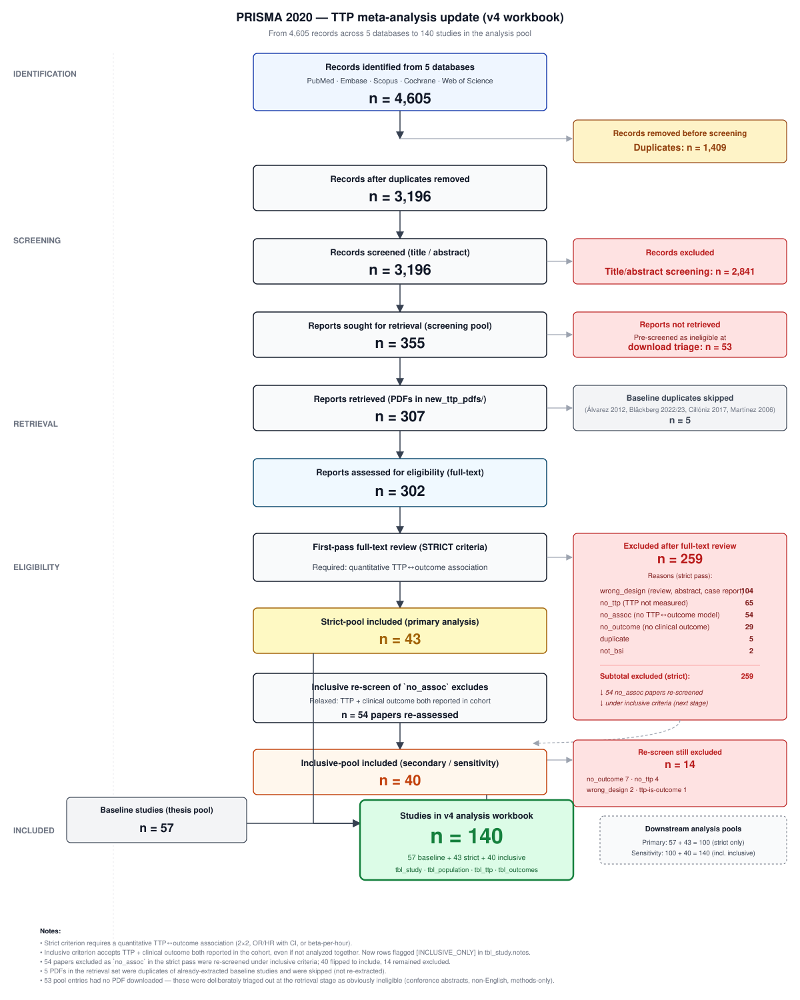

```{r}
#| label: setup
#| include: false
suppressPackageStartupMessages({
  library(tidyverse)
  library(brms)
  library(posterior)
})
source("R/01_prepare_data.R")
source("R/02_fit_models.R")

xlsx <- "data/TTP_MetaAnalysis_Extraction_Complete_v4.xlsx"
es_all  <- prepare_effect_sizes(xlsx, include_inclusive_pool = FALSE, drop_contaminated_ttp = TRUE)
es_mort <- es_for_outcome(es_all, "mortality")
fits    <- fit_all_models(es_mort, cache_dir = "_brms_cache/primary")
base_post <- pooled_summary(fits$fit_base)

n_studies      <- attr(es_all, "n_studies")
n_mort_studies <- n_distinct(es_mort$study_id)
n_es           <- nrow(es_mort)
fmt_or <- function(p) sprintf("%.2f (95%% CrI, %.2f to %.2f)", p$median_OR, p$ci_OR[1], p$ci_OR[2])

load_post <- function(name, dir = "_brms_cache/primary") pooled_summary(readRDS(file.path(dir, paste0(name, ".rds"))))
post_neg  <- load_post("fit_gram_neg")
post_pos  <- load_post("fit_gram_pos")
post_2x2  <- load_post("fit_2x2")
post_rep  <- load_post("fit_reported")
post_inc  <- load_post("fit_base", "_brms_cache/sensitivity")
post_pb   <- load_post("fit_pb")
post_clr  <- load_post("fit_clr")

cut_fit <- summary(readRDS("_brms_cache/primary/fit_cutpoint.rds"))$fixed["cutpoint_c", ]
n_cut_missing <- sum(is.na(es_mort$ttp_cutpoint_hours))
rob <- table(attr(es_all, "tbl_study")$rob_overall)

path_n <- es_mort |> group_by(pathogen_class) |>
  summarise(k = n(), studies = n_distinct(study_id)) |> tidyr::complete(pathogen_class, fill = list(k = 0, studies = 0))
pn <- function(cls, col) path_n[[col]][path_n$pathogen_class %in% cls]
n_unclass <- sum(is.na(es_mort$pathogen_class))
post_fun <- load_post("fit_fungal")
b_gp <- as_draws_df(readRDS("_brms_cache/primary/fit_metareg.rds"))$b_pathogen_classgram_positive
ratio_gp <- c(median(exp(b_gp)), quantile(exp(b_gp), c(.025, .975)))
p_gn_gt_gp <- mean(b_gp < 0)

es_pb  <- es_for_outcome(es_all, "persistent_bacteremia")
es_clr <- es_for_outcome(es_all, "microbiological_clearance")
es_rel <- es_for_outcome(es_all, "relapse")
def_fit <- summary(readRDS("_brms_cache/primary/fit_pb_defgroup.rds"))$fixed
fmt_n <- function(x) format(x, big.mark = ",")

slope_draws <- function(name, par = "b_cutpoint_c")
  as_draws_df(readRDS(file.path("_brms_cache/primary", paste0(name, ".rds"))))[[par]]
fmt_slope <- function(x) sprintf("%.3f (95%% CrI, %.3f to %.3f)", median(x), quantile(x, .025), quantile(x, .975))
sl_all <- slope_draws("fit_cutpoint"); sl_le24 <- slope_draws("fit_cutpoint_le24")
sl_gn  <- slope_draws("fit_gneg_cutpoint"); sl_gp <- slope_draws("fit_gpos_cutpoint")
n_cut <- sum(!is.na(es_mort$ttp_cutpoint_hours))
n_cut_studies <- n_distinct(es_mort$study_id[!is.na(es_mort$ttp_cutpoint_hours)])
cut_med <- median(es_mort$ttp_cutpoint_hours, na.rm = TRUE)
cut_rng <- range(es_mort$ttp_cutpoint_hours, na.rm = TRUE)
cut_med_gn <- median(es_mort$ttp_cutpoint_hours[es_mort$pathogen_class %in% "gram_negative"], na.rm = TRUE)

rma_mort <- metafor::rma(yi = yi, sei = sei, data = es_mort, method = "REML")
egger <- metafor::regtest(rma_mort, model = "lm")
rank_p <- metafor::ranktest(rma_mort)$pval
tf <- metafor::trimfill(rma_mort)

es_inc <- es_for_outcome(prepare_effect_sizes(xlsx, include_inclusive_pool = TRUE, drop_contaminated_ttp = TRUE), "mortality")
n_inc_studies <- n_distinct(es_inc$study_id); n_inc_es <- nrow(es_inc)
cf <- function(name, par) { m <- summary(readRDS(file.path("_brms_cache/primary", paste0(name, ".rds"))))$fixed[par, ]
  sprintf("%.2f (95%% CrI, %.2f to %.2f)", m$Estimate, m[["l-95% CI"]], m[["u-95% CI"]]) }

```

# Introduction

Bloodstream infection is a major cause of morbidity and mortality, and early risk stratification remains a practical clinical problem. Automated continuous-monitoring blood culture systems record the time to positivity (TTP), the interval from the start of incubation to the instrument's detection of microbial growth. Because growth kinetics depend on the starting inoculum and on organism-specific factors, shorter TTP has been proposed as a readily available, laboratory-generated marker of high bacterial burden and severe infection.

Individual cohorts have examined whether TTP carries prognostic information in specific settings, including *Staphylococcus aureus* bacteremia, where TTP has been explored as a marker of endocarditis and poor outcome [@Sowden2008; @Kahn2021; @Stromdahl2025]; Gram-negative bacteremia, including *Pseudomonas aeruginosa* [@Willmann2013; @Tang2017] and *Escherichia coli* [@Martinez2006]; candidemia [@Keighley2023]; and bacteremia in neutropenic patients, where TTP has been suggested as a stewardship tool [@PuertaAlcalde2019]. These studies differ in organism mix, patient population, outcome definition, and, importantly, the TTP threshold used to define "short" versus "long" TTP. Whether the association is consistent across pathogens, whether it varies with the chosen cutpoint, and how large it is once adjusted estimates are considered remain unclear.

We therefore updated a systematic review of the association between blood culture TTP and clinical outcomes in bacteremia. Our primary objective was to estimate the association between short versus long TTP and all-cause mortality using a Bayesian random-effects meta-analysis. Secondary objectives were to examine heterogeneity by pathogen class and by TTP cutpoint, to assess publication bias and the robustness of the findings to study inclusion criteria, and to summarize associations with persistent bacteremia and other markers of clinical failure.

# Materials and Methods

## Protocol and registration

The review is reported according to the PRISMA 2020 statement and the PRISMA-S extension for searches. A protocol was prepared for registration in PROSPERO (registration number: ). The review builds on a master's thesis at the University of Padova (F. Pangallo, 2025/2026; supervisor R. E. Lewis) that produced the original 57-study extraction database. Because that work was substantially complete before the protocol was registered, registration is retrospective for the baseline studies, and the 2026 update (additional search, screening, extraction, and the inclusive-criterion re-screen) was added afterwards. The analysis plan was developed during the thesis; deviations from the protocol are listed in the supplementary notebook ([Methods and PRISMA](notebooks/methods.qmd)).

## Search strategy and study selection

Five databases were searched (PubMed, Embase, Scopus, Cochrane Library, and Web of Science), with an original search and a May 2026 update [insert run dates and per-database record counts]. The searches yielded 4,605 records, with 3,196 unique records after de-duplication. CINAHL, trial registers, and preprint servers were not searched, and no reference-list searching or citation tracking was performed; these are deviations from the registered protocol. Candidate records were triaged for relevance [confirm the role of the Elicit semantic search tool and PubMed enrichment in this step, and reconcile Alvarez 2012 and Peri 2026, which project notes record as handsearch or snowball identifications], and 355 reports were sought for full-text review. Of these, 53 were not retrieved after pre-screening as ineligible (mainly conference abstracts, non-English papers, and methods-only papers), and 302 full-text reports were assessed (5 additional PDFs duplicated baseline studies). Under the strict criterion 43 reports were included, which added to the 57 baseline studies gave 100 studies; 259 were excluded (104 ineligible design, 65 no TTP measured, 54 no quantitative TTP-outcome association, 29 no clinical outcome, 5 duplicates, 2 not bloodstream infection). A second, inclusive re-screen of the 54 reports excluded only for lacking a quantitative association identified 40 further studies (sensitivity pool, 140 studies in total). Eligibility criteria and the full search strings are in the supplementary notebook ([Methods and PRISMA](notebooks/methods.qmd)) and `search_strategies.md`. @fig-prisma shows study flow.

{#fig-prisma width="100%"}

## Data extraction and risk of bias

Data were extracted into a structured relational workbook with linked tables for study characteristics, population, TTP reporting (continuous, dichotomized, or categorical; units; cutpoints), and outcomes (events and totals by TTP group, reported effect estimates, adjustment status, and outcome definitions). TTP was recorded in hours. Where a study reported both 2×2 data and an effect estimate, the 2×2 data were preferred. The baseline 57 studies were extracted by the thesis author [confirm whether extraction was independently verified]. For the 2026 update, full-text screening and data extraction were performed by a large language model agent working from the full-text PDFs and the written eligibility criteria and extraction codebook. Each of the 43 strict-pool extractions was then independently verified field by field against the source PDF by a separate agent that had not performed the original extraction; this led to 7 corrections before analysis. Studies using TTP only as part of a catheter-related bloodstream infection case definition were excluded from effect-size pooling. The human contribution to screening and extraction decisions (spot-checking, adjudication, or second human review) is described in the AI-use statement below [confirm], and we did not perform dual independent human screening or report inter-rater agreement.

Risk of bias was assessed for every included study with the Quality in Prognosis Studies (QUIPS) tool across six domains (participation, attrition, prognostic factor measurement, outcome measurement, confounding, and statistical analysis and reporting), each rated as low, moderate, or high, with an overall rating per study ([notebook](notebooks/rob.qmd)). For the update these ratings were generated by the extraction agent and were not independently re-rated by a second human.

## Statistical analysis

Log odds ratios for mortality (short versus long TTP) were computed with `metafor::escalc()` from 2×2 tables where available, otherwise back-calculated from reported OR, HR, or RR with 95% confidence intervals. Effect sizes were pooled with a Bayesian random-effects model (`brms`; study-level random intercepts) with weakly informative priors ($\mu \sim \mathcal{N}(0,1)$, $\tau \sim \text{Half-Cauchy}(0, 0.5)$). Four chains of 4,000 iterations (1,000 warm-up) were run with `adapt_delta = 0.99`. Convergence was assessed with $\hat{R}$ and effective sample sizes. Secondary analyses examined pathogen class, TTP cutpoint (meta-regression), publication bias, and a sensitivity pool that added studies meeting a more inclusive criterion. All code and data are available in the project repository.

# Results

## Study selection and characteristics

The primary (strict) pool comprised `{r} n_studies` studies, of which `{r} n_mort_studies` reported mortality and contributed `{r} n_es` mortality effect sizes. Overall risk of bias (QUIPS) was low in `{r} rob[["low"]]`, moderate in `{r} rob[["moderate"]]`, high in `{r} rob[["high"]]`, and critical in `{r} rob[["critical"]]` studies ([notebook](notebooks/rob.qmd)).

## Primary analysis

Short TTP was associated with higher mortality (pooled OR `{r} fmt_or(base_post)`; @fig-forest, @tbl-overall). The posterior probability that short TTP increases mortality was `{r} sprintf("%.1f%%", base_post$p_harm * 100)`, and heterogeneity was substantial (median $I^2$ = `{r} sprintf("%.0f%%", base_post$median_i2)`).





## Pathogen class



Pathogen class was available for `{r} nrow(es_mort) - n_unclass` of `{r} nrow(es_mort)` mortality effect sizes (Gram-negative, `{r} pn("gram_negative", "k")` effect sizes from `{r} pn("gram_negative", "studies")` studies; Gram-positive, `{r} pn("gram_positive", "k")` from `{r} pn("gram_positive", "studies")`; fungal, `{r} pn("fungal", "k")` from `{r} pn("fungal", "studies")`; mixed or polymicrobial, `{r} pn("mixed", "k")` from `{r} pn("mixed", "studies")`). The remaining `{r} n_unclass` effect sizes had no pathogen classification and were excluded from the stratified models. Short TTP was associated with higher mortality in Gram-negative bacteremia (OR `{r} fmt_or(post_neg)`) and, with a smaller point estimate and a credible interval that included 1, in Gram-positive bacteremia (OR `{r} fmt_or(post_pos)`; @fig-pathogen-posteriors, @tbl-subgroup). In a meta-regression with both classes, the odds ratio in Gram-positive studies was `{r} sprintf("%.2f", ratio_gp[1])` times that in Gram-negative studies (95% CrI `{r} sprintf("%.2f to %.2f", ratio_gp[2], ratio_gp[3])`), with a posterior probability of `{r} sprintf("%.0f%%", p_gn_gt_gp * 100)` that the association is weaker in Gram-positive studies. This interval is wide and just includes 1, so the evidence for a difference between classes is suggestive rather than conclusive. For fungal bacteremia the pooled estimate was imprecise (OR `{r} fmt_or(post_fun)`, `{r} pn("fungal", "studies")` studies). Heterogeneity remained considerable within both Gram-negative (median $I^2$ `{r} sprintf("%.0f%%", post_neg$median_i2)`) and Gram-positive (`{r} sprintf("%.0f%%", post_pos$median_i2)`) strata.



## TTP cutpoint

A TTP cutpoint was reported for `{r} n_cut` of `{r} n_es` mortality effect sizes (`{r} n_cut_studies` studies); the remainder had no cutpoint recorded in the extraction database. Cutpoints ranged from `{r} cut_rng[1]` to `{r} cut_rng[2]` h (median `{r} cut_med` h). Across all effect sizes with a cutpoint, the log odds ratio changed by `{r} fmt_slope(sl_all)` per additional hour, so higher thresholds were associated with weaker associations (@fig-cutpoint). When the analysis was restricted to cutpoints of 24 h or less, the slope was attenuated and its interval included zero (`{r} fmt_slope(sl_le24)`), so the gradient depends on the few studies using long thresholds.

Within pathogen class the pattern differed. Among Gram-negative effect sizes (median cutpoint `{r} cut_med_gn` h) the slope was positive (`{r} fmt_slope(sl_gn)`; @tbl-gneg-cutpoint), whereas among Gram-positive effect sizes it was negative with an interval that included zero (`{r} fmt_slope(sl_gp)`; @tbl-gpos-cutpoint). The overall negative gradient therefore does not hold within Gram-negative bacteremia, and these class-specific analyses rest on small numbers of effect sizes.







## Publication bias

The funnel plot of mortality effect sizes was asymmetric (@fig-funnel). Egger's regression test indicated small-study effects (t = `{r} sprintf("%.2f", egger$zval)`, df = `{r} egger$ddf`, p `{r} ifelse(egger$pval < 1e-4, "< 0.0001", sprintf("= %.4f", egger$pval))`; @tbl-egger), and the regression-based estimate for a study with zero standard error was close to no association (OR `{r} sprintf("%.2f", exp(egger$est))`; 95% CI `{r} sprintf("%.2f to %.2f", exp(egger$ci.lb), exp(egger$ci.ub))`). Begg's rank correlation test did not detect asymmetry (p = `{r} sprintf("%.2f", rank_p)`). The trim-and-fill method imputed `{r} tf$k0` missing studies and gave an adjusted pooled OR of `{r} sprintf("%.2f (95%% CI, %.2f to %.2f)", exp(tf$beta[1]), exp(tf$ci.lb), exp(tf$ci.ub))`, lower than the unadjusted frequentist estimate (OR `{r} sprintf("%.2f", exp(rma_mort$beta[1]))`). These tests treat all effect sizes as independent, assume that asymmetry is due to selective reporting, and have limited reliability when heterogeneity is high, so they cannot distinguish publication bias from genuine heterogeneity, such as larger associations in smaller studies that used more extreme or optimized cutpoints. The evidence nevertheless suggests that the pooled association may be overestimated.





## Sensitivity analyses

Adding the studies that met only the inclusive criterion increased the number of studies reporting mortality to `{r} n_inc_studies` (`{r} n_inc_es` effect sizes) and gave a pooled OR of `{r} fmt_or(post_inc)`, similar to the primary estimate (@fig-sens-inc). Pooled estimates by data source were consistent in direction. Relative to 2×2-derived effect sizes (`{r} sum(es_mort$es_source == "two_by_two")` effect sizes), the log odds ratio for effect sizes back-calculated from adjusted reported estimates (`{r} sum(es_mort$es_source == "reported_adjusted")` effect sizes) was `{r} cf("fit_es_source", "es_source_freported_adjusted")` and for unadjusted reported estimates (`{r} sum(es_mort$es_source == "reported_unadjusted")` effect sizes) was `{r} cf("fit_es_source", "es_source_freported_unadjusted")`. Both intervals included zero. Directly comparing unadjusted with adjusted reported estimates, the difference in log odds ratio was `{r} cf("fit_adjustment", "adjusted_lblunadjusted")`. Association strength tended to decrease with publication year (change in log odds ratio per year, `{r} cf("fit_year", "year_c")`), with an interval that only just included zero. None of these moderator analyses showed a clear difference, but all were underpowered relative to the observed heterogeneity.



## Clinical failure outcomes

Outcomes other than mortality were reported far less often (@tbl-counts). Persistent bacteremia was the most frequently reported, with `{r} nrow(es_pb)` effect sizes from `{r} n_distinct(es_pb$study_id)` studies, followed by microbiological clearance (`{r} nrow(es_clr)` effect sizes, `{r} n_distinct(es_clr$study_id)` studies). No usable effect sizes were available for relapse (`{r} nrow(es_rel)`).

Short TTP was associated with higher odds of persistent bacteremia (pooled OR `{r} fmt_or(post_pb)`; @fig-pb), with substantial heterogeneity (median $I^2$ `{r} sprintf("%.0f%%", post_pb$median_i2)`). Outcome definitions were not uniform: on review of the outcome definitions, 6 effect sizes defined persistent bacteremia by duration of positive cultures, 3 defined it by endocarditis or valve involvement, and 3 used other definitions. In a meta-regression by definition group, endocarditis-based definitions had a log odds ratio `{r} sprintf("%.2f", def_fit["def_groupendocarditis_IE", "Estimate"])` higher than duration-based definitions (95% CrI `{r} sprintf("%.2f to %.2f", def_fit["def_groupendocarditis_IE", "l-95% CI"], def_fit["def_groupendocarditis_IE", "u-95% CI"])`), which is compatible with no difference given the small number of effect sizes per group. The pooled persistent-bacteremia estimate should therefore be interpreted as an association with a heterogeneous composite of outcomes.

For microbiological clearance, the pooled estimate was too imprecise to interpret (OR `{r} fmt_or(post_clr)`), reflecting only `{r} nrow(es_clr)` effect sizes with very large between-study heterogeneity (median $I^2$ `{r} sprintf("%.0f%%", post_clr$median_i2)`).





# Discussion

In this Bayesian random-effects meta-analysis, short TTP was associated with higher mortality in bacteremia (pooled OR `{r} fmt_or(base_post)`; `{r} n_mort_studies` studies, `{r} n_es` effect sizes). The posterior probability that the association is in the direction of harm was `{r} sprintf("%.1f%%", base_post$p_harm * 100)`. Between-study heterogeneity was moderate to substantial (median $I^2$ `{r} sprintf("%.0f%%", base_post$median_i2)`), and the 95% prediction interval for a new study (`{r} sprintf("%.2f to %.2f", base_post$pi_OR[1], base_post$pi_OR[2])`) is wide and includes no association. The pooled estimate is therefore best read as an average association, not as the effect expected in any particular setting. Adding studies that met only a more inclusive criterion gave a similar estimate (OR `{r} fmt_or(post_inc)`).

**Pathogen class.** The association was larger in Gram-negative bacteremia (OR `{r} fmt_or(post_neg)`) than in Gram-positive bacteremia (OR `{r} fmt_or(post_pos)`), for which the credible interval included 1. The two intervals overlap, so this contrast should be considered hypothesis-generating rather than confirmed. A plausible explanation is that TTP in Gram-positive infection, notably *S. aureus*, is influenced by factors other than burden of disease, such as the source of infection and the presence of endovascular foci, whereas in Gram-negative infection it may track inoculum and host response more directly. This explanation is speculative and was not tested directly here.

**Study design and adjustment.** Effect sizes derived from 2×2 tables (OR `{r} fmt_or(post_2x2)`) were larger than those back-calculated from reported effect estimates (OR `{r} fmt_or(post_rep)`). Meta-regression by data source did not show a clear difference, and the intervals included zero, so the data are compatible with either similar or lower adjusted associations. Crude 2×2 comparisons may carry more confounding by severity of illness, source, or pathogen, in which case the pooled estimate could overstate the independent prognostic contribution of TTP, but the groups also differ in other respects.

**TTP cutpoint.** Studies defined "short" TTP using different thresholds (median cutpoint 12 h), and `{r} n_cut_missing` of `{r} n_es` mortality effect sizes did not have a reported cutpoint. In meta-regression among the remaining effect sizes, the log OR decreased by `{r} sprintf("%.3f", -cut_fit$Estimate)` per additional hour of cutpoint (95% CrI `{r} sprintf("%.3f to %.3f", -cut_fit[["u-95% CI"]], -cut_fit[["l-95% CI"]])`), meaning that stricter (shorter) thresholds were associated with larger odds ratios overall (@fig-cutpoint). This gradient was not robust: it was attenuated when cutpoints above 24 h were excluded, and it was reversed within Gram-negative studies. Because thresholds are often chosen post hoc to maximize discrimination in the study sample, the gradient may partly reflect optimistic cutpoint selection or differences in pathogen mix, and it should not be interpreted as validating any single clinical threshold.

**Other outcomes.** For persistent bacteremia, short TTP was associated with higher odds (OR `{r} fmt_or(post_pb)`), but outcome definitions varied widely between studies. Evidence for microbiological clearance was too sparse and imprecise to interpret (OR `{r} fmt_or(post_clr)`) ([notebook](notebooks/clinical_failure.qmd)).

**Strengths and limitations.** Strengths include a multi-database search with a May 2026 update, a distinction between strict and inclusive study pools, a Bayesian framework that yields prediction intervals and direct probability statements, and a fully reproducible code base. Limitations are substantial. Most included studies were retrospective cohorts and risk of bias was rated moderate or worse in most (`{r} rob[["moderate"]] + rob[["high"]] + rob[["critical"]]` of `{r} sum(rob)` studies). Several studies contributed multiple effect sizes, which we handled with study-level random intercepts but which do not remove all dependence. The TTP threshold, outcome timing, and adjustment sets were not standardized, and adjustment status varied across estimates. Blood culture system, bottle type, transport delay, and prior antibiotic exposure affect TTP and were incompletely reported, so residual confounding by measurement conditions is likely. The funnel plot was asymmetric and Egger's test indicated small-study effects (@fig-funnel, @tbl-egger). Trim-and-fill reduced the pooled estimate to OR `{r} sprintf("%.2f", exp(tf$beta[1]))`, so the primary estimate may overstate the association, although asymmetry can also arise from heterogeneity and cutpoint optimization, and these tests do not account for multiple effect sizes per study. Finally, the meta-analysis is based on aggregate data, which prevents examination of TTP as a continuous predictor within patients.

**Implications.** Short TTP is associated with higher mortality on average, but heterogeneity, the dependence on cutpoint, and probable confounding limit its use as a stand-alone prognostic tool. These results support using TTP as one contextual signal, particularly in Gram-negative bacteremia, alongside clinical severity and pathogen identification. Individual-patient-data analyses with standardized TTP measurement, and prospective validation of pathogen-specific thresholds, are needed before TTP can be used to guide treatment decisions.

# Funding {.unnumbered}

No specific funding was received for this study. The authors are supported by their institutional salaries (University of Padova). [Confirm.]

# Conflicts of interest {.unnumbered}

R.E.L. serves as an Associate Editor at the Journal of Antimicrobial Chemotherapy. The other author declares no conflicts of interest. [Confirm with all co-authors.]

# Data and code availability {.unnumbered}

The extraction workbook, analysis code, and rendered notebooks are included in the manuscript project. [Insert repository and DOI, for example an OSF project, once deposited.]

# Use of artificial intelligence {.unnumbered}

A large language model agent was used to assist with full-text screening and data extraction for the 2026 update, and a second, independent agent verified the extractions against the source PDFs, as described in the Methods. [State the model name and version, how authors reviewed outputs, and who is responsible for the final data. Confirm the wording against ASM's current policy on AI use.] Analysis code was written and run in R and Stan. The authors take responsibility for the content of the manuscript.

# Acknowledgments {.unnumbered}

[None to declare / add acknowledgments.]

# References {.unnumbered}

::: {#refs}
:::
